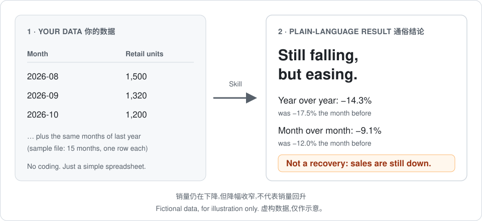

# Automotive Dealer Sales Review Skill

**English** · [简体中文](README.zh-CN.md)

Version 0.1.2 · License: CC BY 4.0

> Turn a monthly sales spreadsheet into a plain-language answer to one question: **is our sales decline getting worse, or easing?**



*Fictional data, for illustration only.*

## The 30-second version

| | |
|---|---|
| **You give it** | A simple table: one row per month, with units sold. 13+ months works best; with less history it still analyzes what the data supports. |
| **You get back** | A short verdict you can use in a monthly review: is the year-over-year and month-over-month decline accelerating or easing, backed by the key numbers. With model, dealer or regional detail, it also shows what pulls the total down and what offsets it. |
| **You need** | An AI app that supports Agent Skills and can read files. The install guide below is written for VS Code + GitHub Copilot (Agent mode). No coding required. |
| **It is not** | Standalone software. It can't be double-clicked and it doesn't connect to your sales system. |

**[Try it on sample data (about 5 minutes) →](#quick-start)** · [Prepare your own data](#prepare-your-own-data) · [FAQ](#faq)

## Who is this for?

- **Sales manager, preparing the monthly meeting.** "Is the decline slowing? Give me one headline and the numbers behind it."
- **Dealer-group analyst, checking before writing the report.** Confirm whether the trend is easing or worsening, and see what the data can't support, before it goes into a deck.
- **Regional or brand manager, looking for what drags the total down.** With model or regional detail, see which items account for the drop and which offset part of it. (This shows the make-up of the change, not its cause.)
- **Someone new to dealer analytics, learning the method.** The skill follows one consistent method (comparable periods, trend judgement, reconciling the parts to the total) and says so when the data is not enough, instead of guessing.

**Honest by design:** no model data means no model analysis. "The decline is easing" is never reported as "sales are recovering."

## Quick start

### 1. Get the tools and the package

This guide covers one route: **VS Code + GitHub Copilot**.

- Install a recent version of [VS Code](https://code.visualstudio.com/), sign in to GitHub Copilot, and confirm that chat offers Agent mode with file access. Account permissions, quotas and organization policies are controlled by the client; having a GitHub account does not mean Copilot is available to you.
- On this repository's page, click **Code → Download ZIP**. After unzipping, you should see `SKILL.md` directly inside the folder. Rename that folder to `automotive-dealer-sales-analysis` (folders downloaded from GitHub usually end in `-main`).
- The package needs no Python, database drivers or other dependencies; reading and calculating data is done by the tools your AI client provides. Start with the sample data, and don't put company files in yet.

### 2. Put it in the right place

Create a trial folder on your computer, for example `sales-demo`, and open it in VS Code with **File → Open Folder**. In the left file panel, create a `.github` folder, then a `skills` folder inside it, and copy the whole `automotive-dealer-sales-analysis` folder into `skills`.

The result should look like this. Make sure there is no extra layer of same-named folders:

```
sales-demo/                 ← the folder you opened in VS Code
└── .github/
    └── skills/
        └── automotive-dealer-sales-analysis/
            ├── SKILL.md
            ├── README.md
            ├── README.zh-CN.md
            ├── LICENSE
            ├── references/
            ├── templates/
            └── assets/
                ├── sample-monthly-sales.csv
                └── example-output.svg
```

### 3. Check that it is installed

Open Copilot Chat and use **Open Customizations → Skills** to see your skills. You can also press `F1` and run **Chat: Open Customizations**. `automotive-dealer-sales-analysis` should appear in the list. Button names may change between versions; see the [official VS Code skills documentation](https://code.visualstudio.com/docs/copilot/customization/agent-skills).

If it doesn't appear, first confirm the `SKILL.md` path matches the diagram above, then reopen the window. If it is still missing, check your client version and organization settings. Don't treat the AI saying "loaded" as the only proof that it is installed.

### 4. Copy this prompt and run the sample

In an Agent chat that can read workspace files, send:

> Use automotive-dealer-sales-analysis to read `.github/skills/automotive-dealer-sales-analysis/assets/sample-monthly-sales.csv`. All rows are complete calendar months for the same fictional dealer scope; retail_units means illustrative retail units. Review October 2026, compare YoY/MoM, and explain whether the decline is accelerating or easing with supporting figures. Do not invent missing dimensions.

**Check the result.** It should find October at 1,200 units, down 200 year over year (-14.3%) and down 120 month over month (-9.1%), and say both declines are smaller than the month before. The wording needn't match, but it must not say sales have recovered. If it can't find the file, check the path above, or attach the sample file through the chat's attachment button.

This install route is written from the official documentation, and the sample figures in this package have been checked arithmetically. **That does not mean it has been tested on every client, version or account.** For other clients that support Agent Skills, follow their own install instructions; this page makes no promise of cross-client compatibility.

## Example analysis (fictional data)

This only shows what the output looks like. The months, store scope, model names and every number are made up and don't represent any real market or business. The figures were checked arithmetically only; no real data source was connected, and no real-world source, coverage or definitions were verified.

> **What can this data support?** The monthly sample CSV contains total retail units only, which supports period comparison and trend judgement. It has no order intake, showroom traffic or dealer detail, so it can't support conversion, model contribution or store ranking. The model and external-market tables below are separate fictional examples showing how a breakdown could look when the data is complete; all numbers are still made up.
>
> **Monthly sample:** a sample authorized dealer, full month of October 2026. Retail units 1,200, down 120 from September (MoM -9.1%) and down 200 from October 2025 (YoY -14.3%).
>
> **Conclusion:** sales are still down both year over year and month over month, but both declines are smaller than the month before. The YoY decline narrowed from 17.5% in September to 14.3% in October, and the MoM decline from 12.0% to 9.1%. This means the downtrend continues but is slowing. It **does not mean sales have recovered**.
>
> | Month | Retail units | YoY change | MoM change |
> |----------|------:|-------------:|-------------:|
> | Aug 2026 | 1,500 | -300 (-16.7%) | -50 (-3.2%) |
> | Sep 2026 | 1,320 | -280 (-17.5%) | -180 (-12.0%) |
> | Oct 2026 | 1,200 | -200 (-14.3%) | -120 (-9.1%) |
>
> The MoM decline narrowed from 12.0% to 9.1%, a 2.9-point improvement; the YoY decline narrowed from 17.5% to 14.3%, a 3.2-point improvement. YoY and MoM use different bases, so the two kinds of decline must not be compared with each other.
>
> **Which models pulled sales down, and which offset part of the drop? (YoY)**
>
> | Model | Same period last year | This period | Change | YoY |
> |-----|------:|------:|---------:|-----------:|
> | Model A | 700 | 500 | -200 | -28.6% |
> | Model C | 450 | 300 | -150 | -33.3% |
> | Model B | 250 | 400 | +150 | +60.0% |
> | Net change | 1,400 | 1,200 | **-200** | **-14.3%** |
>
> Models A and C together lost 350 units, Model B added 150 and offset part of that, for a net loss of 200 that reconciles with the total. The breakdown shows what the change is made of; it doesn't prove why sales fell.
>
> **External market (fictional, same definition):** assume Brand A, Brand B and our Brand C cover the same region, sales events and date window:
>
> | Brand | 2025-10-01 to 10-20 | 2026-10-01 to 10-20 | YoY change |
> |------|-----------------:|-----------------:|-------------:|
> | Brand A | 2,200 | 2,000 | -200 (-9.1%) |
> | Brand B | 1,800 | 1,650 | -150 (-8.3%) |
> | Our Brand C | 1,400 | 1,200 | -200 (-14.3%) |
> | Market total | 5,400 | 4,850 | -550 (-10.2%) |
>
> In this made-up example, our decline is larger than the example market's. Our share of the three-brand total fell from 25.9% to 24.7% (about -1.2 percentage points, computed from unrounded shares). This fictional set only demonstrates market comparison and share calculation; it says nothing about any real market.
>
> **Example confidence: not assessable.** The data is entirely fictional and its source, coverage and definitions are unverified. A real analysis must check those first.

### Sample file you can try right away

[Download the fictional 15-month dealer retail CSV](assets/sample-monthly-sales.csv). It contains only months and retail units, which is enough to try YoY, MoM and trend judgement. It has no real company information and doesn't represent any actual market or business result. Each row is one full calendar month; there is no order, traffic, store or model detail.

## Prepare your own data

A simple sales table is enough to start. The format below is only an illustration; two rows aren't enough to tell whether a decline is continuing or easing:

| Month | Retail units |
|---------|--------:|
| 2025-10 | 1,400 |
| 2026-10 | 1,200 |

- **One row per month, no repeated months.** Don't mix cumulative and single-month figures, and don't fill missing months with 0. Column names can be in Chinese or English and needn't match the sample.
- **Provide 13+ consecutive months, ideally 24+.** 13 months usually lets it compute YoY for the analysis month, but comparing this month's YoY decline with last month's also needs last month's prior-year figure. With less history it can still analyze what exists, but it can't force a trend call.
- **Say what "sales" means.** For example delivered vehicles, invoiced vehicles or registrations, plus the region, store scope and whether returns are included. Definitions should be the same in every period; mention stores that opened, closed or changed scope.
- **If the current month isn't over, give the cutoff date.** To compare in-month progress you need this month, last month and the same month last year at the same point. With only full-month history it can't prorate by days and call that real same-period data.
- **Add detail only if you want model, store or regional analysis.** Explain what each row represents, how models are grouped, and whether stores were renamed or reassigned. If you're unsure, let the AI check and ask.

After the trial, put a file you are authorized to use into `sales-demo`, attach it with the chat's attachment button, and send:

> Please use automotive-dealer-sales-analysis to analyze the attached sales table. The analysis month is [year and month]; sales means [delivered / invoiced / registered, etc.], in vehicles; scope is [region and stores]; data is up to [date]; [returns included? any store-scope changes?]. First check which comparisons the data supports, then give the sales conclusion. Ask me first if anything is unclear.

## FAQ

**Do I need to write code?** Not for the first trial, and no Git commands either. The AI may call calculation tools that you review and approve as the client prompts you. If the tools aren't available, it should say it couldn't verify, not pretend it calculated.

**Can I use Excel directly?** It depends on whether your AI client can read workbooks; this skill doesn't include an Excel reader. If unsure, save the one sheet you want analyzed as CSV UTF-8, keep the column headers, remove merged cells, total rows and note rows, and check that months and numbers converted correctly.

**What if I have less than 13 months of data?** You can still use it. Without last year's figures it can't compute YoY, and without enough history it can't tell whether a decline is narrowing. It should answer the parts it can support and name the gaps.

**Why did it skip the model or store analysis?** Total sales alone can't be split by model or store. Even with such columns, it may decline if many labels are missing or the scope can't be checked.

**Can I upload it to any AI web chat?** "Can attach files" is not the same as "supports installing skills." An ordinary web chat may not load this package or the files it references. Check first that your client supports Agent Skills and file reading.

**Will my company data be uploaded?** The skill does not guarantee local processing. How data is sent, stored and retained depends on your AI client, model service and company configuration. Test with the fictional data first, follow company policy before using real data, and don't upload customer personal information or unauthorized business data.

**Which language does it answer in?** The skill's instructions in `SKILL.md` are written in Chinese. The English prompts above are meant to get English answers, but this has not been tested across clients, so check the first result yourself.

## Files and license

Business users don't need to read every method file first; they are for the AI to follow and for anyone who wants to check the method.

- [SKILL.md](SKILL.md): the skill's entry point and steps.
- [references/methodology.md](references/methodology.md): rules for comparable periods, trend judgement and reconciliation.
- [templates/response.md](templates/response.md): the output format for conclusions, tables and collapsible evidence.
- [assets/sample-monthly-sales.csv](assets/sample-monthly-sales.csv): 15 months of purely fictional monthly retail data.
- [LICENSE](LICENSE): released under [CC BY 4.0](https://creativecommons.org/licenses/by/4.0/). Suggested credit: **Automotive Dealer Sales Analysis Skill**, by **Yumi Kuan**. When redistributing or adapting, keep the credit and license link, and say whether you changed it.

The package contains only methods, templates and fictional samples. It has no real business data, customer or employee personal information, internal addresses, credentials or database connections. It gives no access to any data source; never commit internal adaptations, connection details or real results to a public package.

### Credits

- **Author and method lead: Yumi Kuan.**
- **AI collaboration: assisted by GitHub Copilot in VS Code,** which helped organize the analysis workflow, refine the skill instructions and documentation, design the fictional examples, and check the example calculations and the release package. Business judgement, content choices and the decision to publish are the author's.

Suggested credit line: **Automotive Dealer Sales Analysis Skill — Yumi Kuan; AI-assisted collaboration with GitHub Copilot in VS Code.** This note records AI-assisted contribution and does not mean GitHub, Microsoft or any other organization endorses this project; the license remains CC BY 4.0 as above.

## Found it useful?

- ⭐ **Star** the repository (top right) so more people in the dealer community can find it.
- Tried it on your own data? Tell us what worked and what broke in [Issues](https://github.com/guanyumi235-stack/Automotive-dealer-sales-analysis-skill/issues). Please don't paste real business data.
- Want a version for the service department, used cars or another scenario? Suggest it in Issues too.
